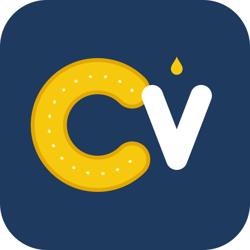
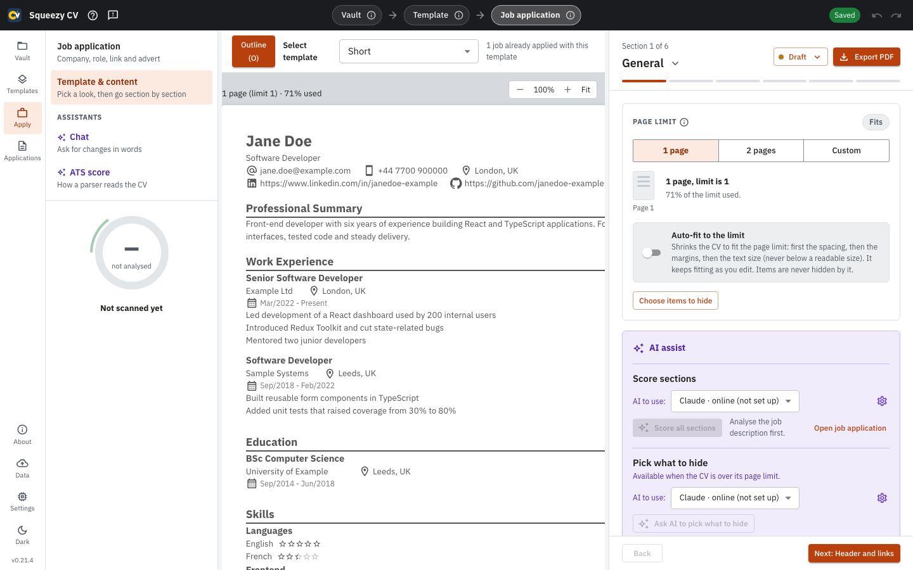

<div align="center">



# Squeezy CV

### Keep everything. Squeeze what fits.

A personal CV app. Write your facts **once**, then make a tailored, one-click-PDF CV for every job you apply to.

**[Try it in your browser: squeezy-cv.pages.dev](https://squeezy-cv.pages.dev)** (free, no account, your data stays on your device)



<a href="https://ko-fi.com/mohammadamirshahi"></a>

<sub>Free, and I build it in my own time. If it helped you land an interview, a coffee keeps it going.</sub>

<br>

[What it is](#what-it-is) · [Why this app](#why-this-app-and-not-another-cv-builder) · [Two ways to run it](#two-ways-to-run-it) · [Install](#install-and-run) · [Tutorials](#learn-it-the-tutorials) · [Docs](#more-documentation) · [Licence](#licence)

</div>

---

## What it is

Most CV tools give you **one document** and you copy it, rename it and edit it for every application. After ten applications you have ten slightly different files and no idea which one has the newest phone number.

Squeezy CV keeps all of it **on your own machine**, private, and not on anyone's server, and it splits the problem into four things:

| Part            | What it is                                                                                                                | Think of it as   |
| --------------- | ------------------------------------------------------------------------------------------------------------------------- | ---------------- |
| **Vault**       | Every fact about you: jobs, education, skills, projects, links, all the bullet points. Written once.                      | your memory      |
| **Template**    | How a CV _looks_: sections, order, layout, fonts, colours.                                                                | your paper       |
| **Job**         | One target. It picks a template, sets the page limit, decides what to show from the vault per section, and can reword it. | one application  |
| **Application** | A frozen copy of exactly what you sent (with the PDF), plus status and follow-ups.                                        | your paper trail |

You check the result on a live **A4 preview**, export a **PDF**, and optionally let **AI** help tailor a job to an advert (always marked with the purple sparkle, always shown to you before anything changes).

- **Web app:** React 19, TypeScript, Vite, MUI, Redux Toolkit.
- **Local server (server mode only):** Fastify. Stores your data as JSON files on your computer and makes the PDF with headless Chromium.
- **Private by default.** Nothing leaves your machine unless you choose an online AI provider, and even then your name, email, phone and employers are replaced with placeholders first (best effort: you see the exact text before it is sent, and dates and wording still go along).

## Why this app and not another CV builder

<details open>
<summary><b>The vault logic: write once, show differently every time</b></summary>

<br>

- **One source of truth.** Change your phone number or fix a typo in one place and every future CV has it. There is no "which file is the latest" problem.
- **Hiding is not deleting.** On a job you hide what does not fit (the old internship, the unrelated project). The vault keeps it, so the next job can show it again. You can put in _everything_ you have ever done without worrying about a long CV.
- **Wording belongs to the job.** Rewrite a bullet for one advert and only that job changes. The vault keeps your plain version.
- **Look and content are separate.** Redesign a template once and every job that uses it follows. Switch a job from a two-column to a one-column look without touching a single word.
- **Squeeze to fit.** Set a page limit and the app helps you choose what to hide until it fits, instead of you fighting margins by hand.
- **Nothing is lost when you apply.** Sending marks the job as an **application**: a frozen copy of what you sent, with the PDF. Edit the vault tomorrow and the history stays true.

</details>

<details>
<summary><b>How it compares</b></summary>

<br>

|                                 | Squeezy CV                    | Typical online CV builder        | A Word / Google Docs file   |
| ------------------------------- | ----------------------------- | -------------------------------- | --------------------------- |
| Facts stored once, reused       | yes (the vault)               | sometimes, per account           | no, copy and paste          |
| A different CV per job          | yes, jobs share the vault     | duplicate the whole CV           | duplicate the file          |
| Keeps a record of what you sent | yes (applications, with PDF)  | rarely                           | only if you save every copy |
| Your data                       | on your device, plain JSON    | on their servers, an account     | on your disk or their cloud |
| AI                              | optional, masked, shown first | often built in, sends everything | none                        |
| Price                           | free                          | free tier, then subscription     | free                        |
| Works offline                   | yes (installable)             | no                               | yes                         |

</details>

## Two ways to run it

Both run the **same app**, with the same screens and the same data format. They differ in where your data lives and what does the heavy work. **Most people should use browser mode**: nothing to install, and your data still stays on your device. Server mode is for developers who work on the code, and for anyone who wants everything as plain files plus a few extras (see below).

<table>
<tr>
<th></th>
<th>Browser mode<br><sub>recommended for most people</sub></th>
<th>Server mode<br><sub>for developers and self-hosting</sub></th>
</tr>
<tr>
<td><b>Install needed</b></td>
<td>None. Open the website, or build it yourself.</td>
<td>Git, Node, pnpm, Chromium</td>
</tr>
<tr>
<td><b>How to start</b></td>
<td><code>pnpm dev:browser</code> or <code>pnpm build:browser</code></td>
<td><code>pnpm dev</code></td>
</tr>
<tr>
<td><b>What runs</b></td>
<td>Only a static web app. Can be installed like an app (PWA).</td>
<td>The web app (:5173) plus a local Fastify server (:3001)</td>
</tr>
<tr>
<td><b>Where your data lives</b></td>
<td>IndexedDB in the browser, <b>or</b> a folder you pick (Chrome/Edge)</td>
<td>JSON files in <code>data/</code>, with <code>.bak</code> copies, optional git backup</td>
</tr>
<tr>
<td><b>PDF export</b></td>
<td>The browser's print dialog ("Save as PDF")</td>
<td>Headless Chromium (Playwright) on the server</td>
</tr>
<tr>
<td><b>AI keys</b></td>
<td>Your own key, in this browser's <code>localStorage</code> (never in a backup)</td>
<td>In <code>.env</code> on the server, never sent to the browser</td>
</tr>
<tr>
<td><b>AI calls</b></td>
<td>Straight from the browser</td>
<td>Through the server</td>
</tr>
<tr>
<td><b>Moving your data</b></td>
<td>Download or restore a full backup file ("Your data" dialog), or use a synced folder</td>
<td>Copy the <code>data/</code> folder, or point <code>DATA_DIR</code> at a synced folder</td>
</tr>
<tr>
<td><b>Not available</b></td>
<td>Git backup</td>
<td>Nothing</td>
</tr>
</table>

> [!IMPORTANT]
> **The main trade-off.** Server mode keeps your data in plain files on your disk. In browser mode the data lives only in _that browser on that device_: clearing site data, a private window or another device means it is gone. Make regular backups, or [store your data in a synced folder](docs/sync-with-a-folder.md) (Dropbox, Drive, iCloud, OneDrive), which also gives you a second device. The folder uses the same layout as `data/`, so either mode can open it.

<details>
<summary><b>So why would I pick server mode?</b></summary>

<br>

Honestly, for most people you would not. Server mode adds a few things:

- **Git backup.** If `data/` is its own private git repository, the server commits after every save.
- **A real PDF file per application.** The server makes the PDF with headless Chromium and stores `cv.pdf` with the application. In browser mode the PDF is drawn again from the frozen copy of the CV when you open it, and you save it through the print dialog.
- **Plain files in any browser.** Browser mode can also write to a folder, but only in Chrome and Edge on a computer. Server mode always writes ordinary files, whichever browser you open it in.
- **Keys stay off the browser.** AI keys live in `.env` on the server instead of in the browser's `localStorage`.
- **You can change the code.** It is the setup for developing and testing Squeezy CV itself.

</details>

<details>
<summary><b>How the two modes share one codebase</b></summary>

<br>

The app talks to one storage interface, `CvStorage`. Server mode implements it with files (`FileCvStorage`); browser mode implements it with IndexedDB (`IdbCvStorage`), and `src/web/store/persistence/browser/local-api.ts` answers the same API routes locally. The AI routes live once in `src/server/ai/ai-routes.ts` and run in both. The rule for contributors: **a change to a server route needs the same change in `local-api.ts`.**

More in [`docs/hosting.md`](docs/hosting.md) and the "Browser mode" section of the data model notes in `.claude/skills/squeezy-cv-reference/references/data-model.md`.

</details>

## Install and run

### Option A: browser mode, nothing to install

1. Open the hosted app: <https://squeezy-cv.pages.dev>. It is free and needs no account; your data stays in your browser (see [docs/hosting.md](docs/hosting.md) for how it is hosted).
2. Optional: install it. In Chrome or Edge use the install icon in the address bar; on a phone use "Add to Home Screen".
3. Open **Your data** and choose where to keep it. Pick a folder (Chrome/Edge on a computer) or make a **backup file** now and then.
4. Optional AI: open the AI settings and paste your own key (Gemini and Groq have free tiers).

Prefer to host it yourself? Run `pnpm dev:browser` after the setup below, or `pnpm build:browser` and put the `dist` folder on any static host.

### Option B: server mode, step by step

<details open>
<summary><b>1. Install the tools (once)</b></summary>

<br>

You need Git, Node.js (current LTS, 24 recommended) and pnpm. Details and Ollama are in [section 1 below](#1-prepare-your-computer).

```bash
node -v          # should print v22 or newer
corepack enable  # makes pnpm available (or: npm install -g pnpm)
```

</details>

<details open>
<summary><b>2. Get the code and install</b></summary>

<br>

```bash
git clone https://github.com/smamirshahi/squeezy-cv.git
cd squeezy-cv
pnpm install
pnpm exec playwright install chromium   # about 110 MB, needed for PDF export
```

</details>

<details open>
<summary><b>3. Start it</b></summary>

<br>

```bash
pnpm dev
```

Open <http://localhost:5173>. The first time there is no saved CV; in development the app shows a fake sample so you can look around. Use **Import JSON**, **Paste CV text** (AI) or type your own, then press **Save**.

</details>

<details>
<summary><b>4. Optional: AI</b></summary>

<br>

```bash
cp .env.example .env    # then add a key, or set AI_PROVIDER=ollama for free local AI
```

Restart `pnpm dev`. Full list of providers in [AI setup](#3-optional-ai-setup).

</details>

## Learn it: the tutorials

The tutorials are **inside the app**, so you learn on the real screens. There are six, short and in this order:

| #   | Tutorial                 | What you learn                                                    |
| --- | ------------------------ | ----------------------------------------------------------------- |
| 1   | **How Squeezy CV works** | Vault, template and job in three steps (start here)               |
| 2   | **Your vault**           | What to put in it, why it stays on your device, how to back it up |
| 3   | **Your templates**       | Layout, sections and style                                        |
| 4   | **Applying for a job**   | From the advert to a saved application                            |
| 5   | **Your applications**    | Statuses, what you sent and follow-ups                            |
| 6   | **Using AI safely**      | Online or offline AI, masking, what is sent                       |

**How to run them**

1. Start the app (browser mode: open the site; server mode: `pnpm dev`).
2. The Welcome tutorial opens by itself on your first visit. Use **Next** to go through it, then the last button (for example **Start building**) closes it.
3. To open any tutorial later, click the **Tutorials** icon in the top bar and pick one from the list on the left.
4. Do not want it to open on start? Switch on **Don't show tutorials on start** inside the dialog.
5. The AI tutorial also opens the first time you open the AI settings.

**Suggested first 15 minutes:** do tutorial 1, then fill your vault (tutorial 2), pick a template (3), make your first job from a real advert (4), and export the PDF.

<details>
<summary><b>I just want to see it working (no data of my own)</b></summary>

<br>

`data.example/` holds a fake CV. In server mode copy it to start from it: `cp -R data.example data`. In development the app also shows a sample CV when nothing is saved.

</details>

## More documentation

- [docs/hosting.md](docs/hosting.md): the hosted browser version and what deploys when
- [docs/sync-with-a-folder.md](docs/sync-with-a-folder.md): keep your data in Dropbox, Drive, iCloud or OneDrive
- [docs/design-language.md](docs/design-language.md): the allowed UI looks (for contributors)
- [CHANGELOG.md](CHANGELOG.md): what changed in each version
- [CLAUDE.md](CLAUDE.md): architecture for contributors

---

# Server mode in detail

Everything below is about server mode, the developer version.

## 1. Prepare your computer

Install these once.

| Tool                                       | Why                                     | How                                                                                                                        |
| ------------------------------------------ | --------------------------------------- | -------------------------------------------------------------------------------------------------------------------------- |
| **Git**                                    | clone the project; optional data backup | macOS: `xcode-select --install` or `brew install git`                                                                      |
| **Node.js** (current LTS, 22 or newer)     | runs the app and the server             | <https://nodejs.org> or `brew install node` (check with `node -v`)                                                         |
| **pnpm**                                   | package manager (the project uses it)   | `corepack enable` (comes with Node), or `npm install -g pnpm`                                                              |
| **Chromium for Playwright** (about 110 MB) | PDF export and the browser tests        | after installing the dependencies: `pnpm exec playwright install chromium` (goes to the Playwright cache, not to the repo) |
| **Ollama** (optional)                      | free AI that runs on your computer      | see [AI setup](#3-optional-ai-setup)                                                                                       |

Then:

```bash
git clone https://github.com/smamirshahi/squeezy-cv.git squeezy-cv
cd squeezy-cv
pnpm install
pnpm exec playwright install chromium
```

## 2. Run it

```bash
pnpm dev
```

- Web app: <http://localhost:5173>
- API server: <http://localhost:3001> (Vite forwards `/api` to it)

On the first start there is no saved CV. In development the app shows a fake sample CV (unsaved) so you can try it. To start with your own data, use **Import JSON**, **Paste CV text** (AI) or type it in, then press **Save**.

**PDF export** needs two things: Chromium installed (step 1) and the web app running (the server opens it in a headless browser).

### Configuration

The server reads these environment variables (put them in `.env`, see below):

| Variable   | Default                 | Meaning                                       |
| ---------- | ----------------------- | --------------------------------------------- |
| `PORT`     | `3001`                  | server port                                   |
| `DATA_DIR` | `./data`                | where your CV files are saved                 |
| `WEB_URL`  | `http://localhost:5173` | where the web app runs (must be this machine) |

### Commands

| Command             | What it does                                                                        |
| ------------------- | ----------------------------------------------------------------------------------- |
| `pnpm dev`          | web and server together. `pnpm dev:web` or `pnpm dev:server` runs only one          |
| `pnpm server`       | run the server once, without watching                                               |
| `pnpm build`        | type-check and build the web app                                                    |
| `pnpm test`         | unit and component tests (Vitest). `pnpm test:watch` to keep it running             |
| `pnpm test:e2e`     | real-browser tests (starts its own server on a temporary folder, Vite and Chromium) |
| `pnpm lint:check`   | ESLint, no changes (CI runs this). `pnpm lint` fixes                                |
| `pnpm format-check` | Prettier check. `pnpm format-fix` fixes                                             |
| `pnpm data:push`    | push the data repo to its remote (see [Backup](#backup-with-git-optional))          |

CI runs build, lint, format check and tests on every pull request.

## 3. Optional: AI setup

The AI helps with tailoring a job to an advert, pasting CV text, choosing what to hide to fit the page limit, and the chat panel. **The app works fully without it.** Every change the AI suggests is shown first and only applied when you approve it.

Copy the example settings file and edit it. `.env` is git-ignored, and only the server reads it. Keys are never sent to the browser.

```bash
cp .env.example .env
```

You can use any of these providers. In the app, **AI setup** (left rail) lets you choose the provider per task. A provider only appears there when it is set up.

| Provider   | Cost      | Where your text goes              | Setup in `.env`                                      |
| ---------- | --------- | --------------------------------- | ---------------------------------------------------- |
| **Ollama** | free      | stays on your computer            | `AI_PROVIDER=ollama` (no key)                        |
| **Claude** | paid      | Anthropic                         | `ANTHROPIC_API_KEY=...` (optional `ANTHROPIC_MODEL`) |
| **Gemini** | free tier | Google (may be used for training) | `GEMINI_API_KEY=...`                                 |
| **Groq**   | free tier | Groq (check their data terms)     | `GROQ_API_KEY=...`                                   |

Restart `pnpm dev` after changing `.env`.

**Groq models.** Groq changes which models a key can use, and some (such as the Llama ones marked "Enterprise / Contact Sales") answer `404 model does not exist` on a normal key. The current list is at <https://console.groq.com/docs/models>. Pick a model that is listed under Production Models without "Contact Sales" and set it in `.env`, for example `GROQ_MODEL=openai/gpt-oss-120b` (the default; `openai/gpt-oss-20b` is smaller and faster). If you get a 404, check that page first.

Before anything is sent to an online provider, a **Send to AI** window shows the exact text. Your name, email, phone, address, links, employers and schools are already replaced with placeholders (`[Company 1]`); you can switch each off, select any other word or phrase to hide it everywhere, and mark a job advert as private. The model's answer gets the real words back on your computer. Dates and wording are still sent, so they can identify you. For anything sensitive, use Ollama, which stays on your computer and shows no window.

### Installing Ollama (local, free, private)

1. Install it from <https://ollama.com> (on macOS also `brew install ollama`).
2. Make sure it is running (the desktop app starts it, or run `ollama serve`).
3. Download a model (a few GB):

   ```bash
   ollama pull llama3.1
   ```

4. In `.env` set `AI_PROVIDER=ollama`, then restart `pnpm dev`.

Optional settings: `OLLAMA_MODEL` (default `llama3.1`), `OLLAMA_URL` (default `http://127.0.0.1:11434`, must be this machine), `OLLAMA_NUM_CTX` (default `16384`; a CV and its prompt need a large context).

Local models on a CPU are slow, often several minutes per request. A smaller model such as `llama3.2:3b` is much faster but gives weaker results. A hosted model (Claude) is faster and better.

## 4. Where things are saved

Your real data lives in **`data/`** inside the project (or in `DATA_DIR`). It is git-ignored so personal details are never committed.

```text
data/
  vault.json                       all your facts: profile, links, sections, items, bullets
  vault.json.bak                   the previous readable version
  templates/<id>.json              a look: layout, style, skill display
  jobs/<id>.json                   one target: its template, which items are shown, order, wording
  applications/<id>/
    application.json               one application: company, role, status, timeline, the CV as sent
    cv.pdf                         the exact PDF that was sent
```

- **Old data (before 0.2):** `variants/<id>.json` files are still read. Each one shows up as a template plus a job with the same name, and is written out to `templates/` and `jobs/` the first time you save. The old files are never deleted.
- **Nothing is saved automatically.** The **Save** button writes what changed. If you close the tab with unsaved changes, the browser warns you.
- Writes are atomic (temporary file, then rename). The last good version is kept as `.bak`. A file that cannot be read is moved to `.corrupt-<time>` and is never treated as empty, and saving is blocked while the data cannot be read, so the empty default CV never overwrites a file.
- Export and import: **Export PDF** downloads a PDF (optionally also JSON). The Settings pages import and export a JSON file. Older export formats are migrated automatically.
- `data.example/` shows the layout with a fake CV. To start from it: copy that folder to `data/`.
- Other local files, all git-ignored: `.env` (settings and keys), `.ai-settings.json` (which provider you chose per task, no secrets), and the chat history per job, kept in your browser's `localStorage`.

### Backup with git (optional)

Make `data/` its own **private** repository:

```bash
cd data
git init
git remote add origin <your PRIVATE repo URL>
```

Once `data/` has its own `.git`, the server commits after every save. Pushing is always explicit: `pnpm data:push` (or `POST /api/backup/push`). If git fails, saving still works. Never put your CV in a public repository.

## 5. Project structure

```text
src/
  web/      the React app (entry: main.tsx)
    components/  shared UI pieces
    custom-styles/  theme, fonts, colours
    hooks/       React hooks
    pages/       workspace, editors, preview, tailor (AI), applications, print view
    store/       Redux slices: vault, cvData, app, variants (holds the templates and jobs), persistence, history
  server/   the local API (Fastify; entry: main.ts)
    storage/     reading and writing the JSON files
    pdf/         PDF export with Playwright and Chromium
    ai/          AI providers, prompts (ai/prompts/*.md), tailoring, import, chat
    backup/      optional git commits of the data folder
  shared/   code used by both sides (no React, Redux or Node APIs)
    custom-types/  the runtypes schemas
    vault/  variant/  layout/  ai/  application/  export/  chat/   pure logic
  e2e/      real-browser tests (pnpm test:e2e)
fixtures/       fake data for tests
data.example/   example data layout
data/           YOUR data (git-ignored)
.env            YOUR settings and keys (git-ignored)
```

Tests sit next to the code as `*.test.ts(x)`.

Imports must use path aliases, not relative paths (ESLint enforces it): `@components/*`, `@hooks/*`, `@pages/*`, `@store/*`, `@custom-styles/*`, `@shared/*`, `@custom-types/*`, `@server/*`, `@fixtures/*`, `@e2e/*`.

More detail on the architecture (templates and jobs, state, pagination, PDF, AI and so on) is in [CLAUDE.md](CLAUDE.md).

## Versions

The current version is shown at the bottom of the tool rail and in `GET /api/health`. What changed in each version is in [CHANGELOG.md](CHANGELOG.md).

## 6. Troubleshooting

- **PDF export fails:** run `pnpm exec playwright install chromium` and make sure the web app is running at `WEB_URL`.
- **"Server offline" banner:** the API is not running. Use `pnpm dev`, not only `pnpm dev:web`.
- **Saving is blocked:** the saved data could not be read. Look in `data/` for a `.corrupt-*` file or the `.bak`; do not delete them.
- **AI says "not configured":** check `.env`, then restart. For Ollama check that it is running (`ollama list`) and that the model was pulled.
- **AI request times out:** local models are slow on a CPU. Use a smaller model or a hosted provider.
- **Port in use:** change `PORT` for the server, or stop whatever uses 3001 or 5173.

### Still stuck, found a bug, or have an idea?

Please tell me. It helps everyone who uses Squeezy CV.

1. **In the app:** click the **Send feedback** icon in the top bar, choose the kind (Feedback, Bug or Feature) and write a note.
   - Browser mode: **Open on GitHub** opens a new issue with your note already filled in (you need a GitHub account). **Copy the text** is there if you prefer to send it another way.
   - Server mode: with `FEEDBACK_GITHUB_TOKEN` set in `.env`, the server creates the GitHub issue for you; without it, use step 2.
2. **On GitHub:** [open an issue](https://github.com/smamirshahi/squeezy-cv/issues/new) yourself. Say what you did, what you expected and what happened. Mention whether you use browser or server mode and your browser. Never paste your real CV, keys or `.env` into an issue.

## Licence

Squeezy CV is **free for non-commercial use**: you can use it, change it and share it for personal, educational, charity and other non-commercial purposes. Commercial use (selling it, offering it as a paid service, or using it inside a business) needs my permission. The terms are the [PolyForm Noncommercial License 1.0.0](LICENSE). Pull requests are not accepted for now, see [CONTRIBUTING.md](CONTRIBUTING.md); to report a security problem see [SECURITY.md](SECURITY.md).

## Credits

City suggestions in the location fields use data from [GeoNames](https://www.geonames.org/) (CC BY 4.0), see `scripts/build-cities.mjs`.
